# 事件 × 圖片對照稽核（2026-11-15）

> 用途：讓人工判斷每張事件卡配的圖對不對。
> 繪圖綁定在 `src/game/eventArt.ts`（`EVENT_ART`），一個 event id 固定一張圖；改隨機種子只改變事件出現的順序，**不會**重新配圖。
> **2026-11-15 已處理**：P4／C1／SC2 換新圖；艦長日誌改成每個 sol 固定一張圖（`SOL_BRIEF_ART`），不再借當天事件圖。
> 事件內容以 `src/game/events.ts` 為準；效果數字為程式現值。

## 總覽

| ID | 類別 | Sol | 標題 | 圖片 | 配圖評價 |
|---|---|---|---|---|---|
| T1 | power | 1 | 希望一號的第一道命令 | `21-shadow-hero.webp` | ✅ 對 |
| P1 | power | 2–6 | 太陽能板積塵 | `37-night-dust.webp` | ✅ 對 |
| P4 | power | 2–6 | 寒流來襲，暖氣耗電 | `38-cold-week.webp` | ✅ 對（結霜＋暖氣） |
| L1 | lifeSupport | 2–6 | 氧氣回收機故障 | `32-oxygen-unit.webp` | ✅ 對 |
| L2 | lifeSupport | 2–6 | 水循環堵塞 | `34-water-line.webp` | ✅ 對 |
| L3 | lifeSupport | 3–6 | 二氧化碳超標 | `36-co2-scrubber.webp` | ✅ 對 |
| S1 | shield | 4 | 太陽閃焰警報 | `08-control-room.webp` | ✅ 對（螢幕示警） |
| S2 | shield | 2–6 | 微隕石擊穿外牆 | `31-meteorite-breach.webp` | ✅ 對 |
| S3 | shield | 3–5 | 避難艙檢查 | `33-shelter-door.webp` | ✅ 對 |
| F1 | food | 3–7 | 溫室番茄豐收 | `09-greenhouse.webp` | 🔶 尚可（只有一顆熟番茄） |
| F3 | food | 2–6 | 補給箱延誤 | `35-supply-crate.webp` | ✅ 對 |
| C1 | comms | 3–5 | 地球來電 | `39-earth-call.webp` | ✅ 對（無線電台＋地球訊號） |
| SC2 | science | 2–6 | 地下冰探測 | `40-ice-survey.webp` | ✅ 對（鑽孔＋地層亮層） |

「簡報圖」欄位說明：艦長日誌已改成每個 sol 固定一張（`SOL_BRIEF_ART`）；事件卡的 `briefingSrc` 只在 sol 超出 1–7 時當後備。

---

## 逐張內容

### T1 — 希望一號的第一道命令（First Order at Hope-1）
- 類別／角色：power／暗影；Sol 1 固定教學。
- 簡報文：「太陽升起，迫降揚起的沙塵蓋住一部分{{太陽能}}陣列。暗影拿著刷子在外面等你的決定。」
- 選項：
  1. 清掃太陽能板（⚡+6／💧−3／❤️−5；知識卡 solarPower）
  2. 讓大家先休息（❤️+6／⚡−7）
- 圖片：`scenes/21-shadow-hero.webp` — 黃昏的太陽能板陣列，暗影穿深色太空衣站在板面上，背後是基地圓頂。
  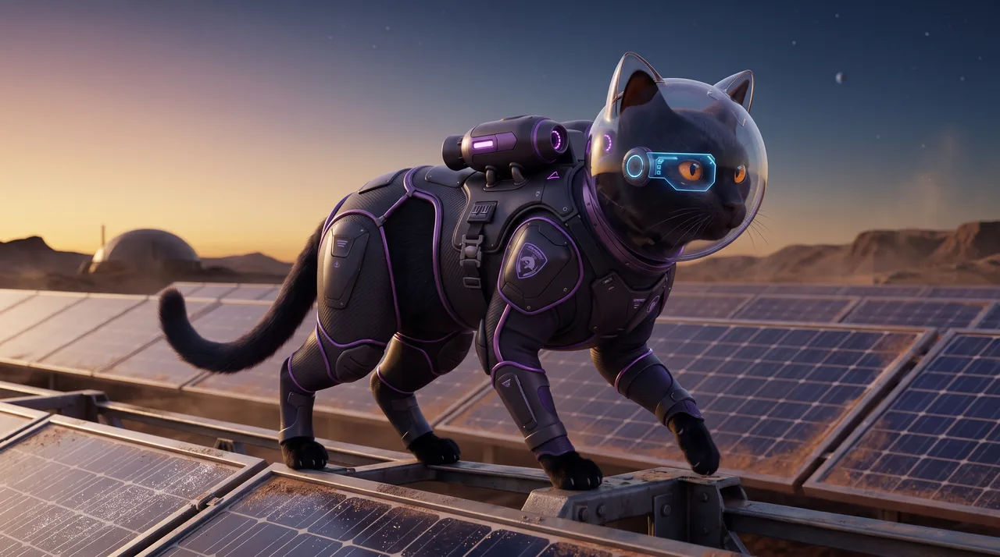
  - 檔名：`scenes/21-shadow-hero.webp`
- 簡報底板：`21-shadow-hero-nocat.webp`（sol 固定圖上線後只在 sol 超出 1–7 時當後備）；掃沙小遊戲用 `21-shadow-hero-nocat.webp` → 清乾淨後換 `21-shadow-hero-nocat-clean.webp`。
- 評價：✅ 圖文一致（積塵的太陽能板＋暗影）。

### P1 — 太陽能板積塵（Dust on the Solar Panels）
- 類別／角色：power／暗影；Sol 2–6，`power < 65` 或 `crashDust`，且 `power < 80`。
- 簡報文：「{{沙塵暴}}的沙塵蓋住{{太陽能}}板，發電量正在下降。」
- 選項：
  1. 派暗影清潔（⚡+10／❤️−2；solarPower）
  2. 震動除塵（⚡+8／❤️−1；20% 失敗 ⚡−5／❤️−3）
  3. 先不理它（⚡−4／❤️+2，持續 2 sol）
- 圖片：`scenes/37-night-dust.webp` — 夜空下的太陽能板，暗影在板面上掃塵，銀白在地面，金桔坐在探測車裡。
  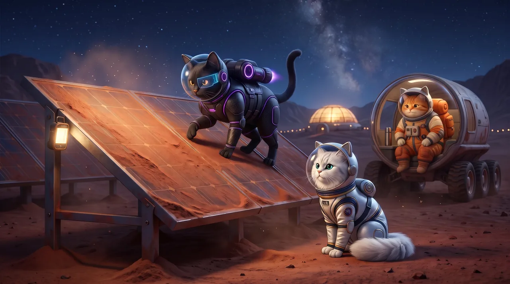
  - 檔名：`scenes/37-night-dust.webp`
- 簡報底板：`37-night-dust-nocat.webp`（同上，只在 sol 超出 1–7 時當後備）；掃沙小遊戲借用 T1 的乾淨／積塵板。
- 評價：✅ 圖文一致；與 T1 同一座陣列、不同時間，合理。

### P4 — 寒流來襲，暖氣耗電（The Cold Week Drains Power）
- 類別／角色：power／金桔；Sol 2–6，只在天氣 `cold_snap`／`severe_cold`。
- 簡報文：「稀薄的{{大氣層}}留不住熱，保持基地溫暖正在吃掉電力。」
- 選項：
  1. 加強保溫（⚡−8／💧+6／❤️+2；atmosphere）
  2. 調低暖氣（⚡+6／💧−3／❤️−5）
  3. 燒備用燃料（⚡−12／💧+4／❤️+10）
- 圖片：`scenes/38-cold-week.webp` — 黃昏結霜的基地艙體，金桔趴在窗內暖氣旁，外牆貼著菱格保溫板、暖氣口亮著。
  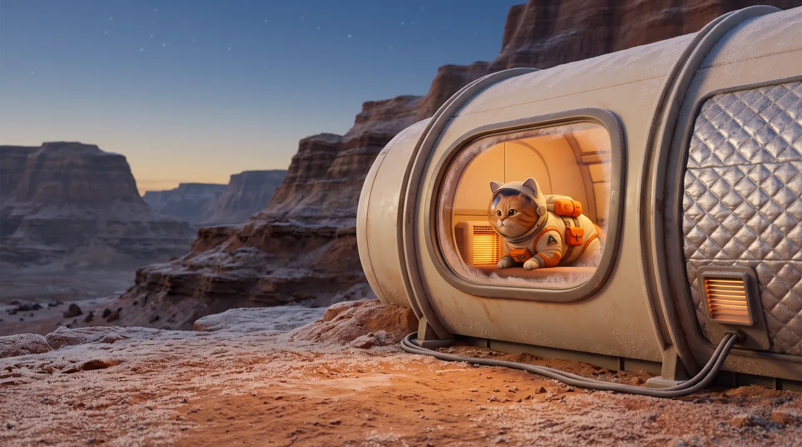
  - 檔名：`scenes/38-cold-week.webp`
- 簡報底板：`38-cold-week-nocat.webp`（同一場景，窗內沒有貓；同上，只在 sol 超出 1–7 時當後備）。
- 評價：✅ 對題。霜、保溫板、暖光與暖氣口同時出現，配合「保暖正在吃電」；金桔在室內也對到角色。

### L1 — 氧氣回收機故障（Oxygen Recovery Failure）
- 類別／角色：lifeSupport／暗影；Sol 2–6，`lifeSupport < 65`。
- 簡報文：「{{氧氣回收}}機故障，氧氣濃度正在下滑。」
- 選項：
  1. 立即維修（⚡−15／💧+18；oxygenRecovery）
  2. 旁通運轉（⚡+5／💧−10）
  3. 請暗影處理（💧+15；用掉暗影專長）
- 圖片：`scenes/32-oxygen-unit.webp` — 夜間基地內，氧氣機艙門打開透青光，維修機器人伸臂檢修，暗影坐在旁邊。
  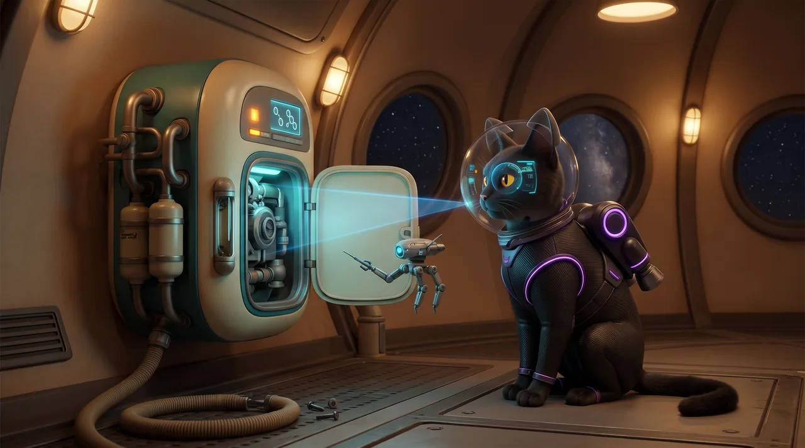
  - 檔名：`scenes/32-oxygen-unit.webp`
- 簡報圖：無（直接用卡片圖）。
- 評價：✅ 圖文一致。

### L2 — 水循環堵塞（Water Recycling Clog）
- 類別／角色：lifeSupport／金桔；Sol 2–6，`lifeSupport < 70`。
- 簡報文：「{{水循環}}系統堵塞，回收的水變少了。」
- 選項：
  1. 拆管清洗（⚡−6／💧+12／❤️−2；waterRecycling）
  2. 化學沖洗（💧+8／🍖−1）
  3. 限水（⚡+6／💧−6／❤️−2）
- 圖片：`scenes/34-water-line.webp` — 金桔蹲在漏水、生鏽的管線接頭旁，機械臂轉緊接頭，水滴滴進金屬盆，背後是溫室粉紫燈。
  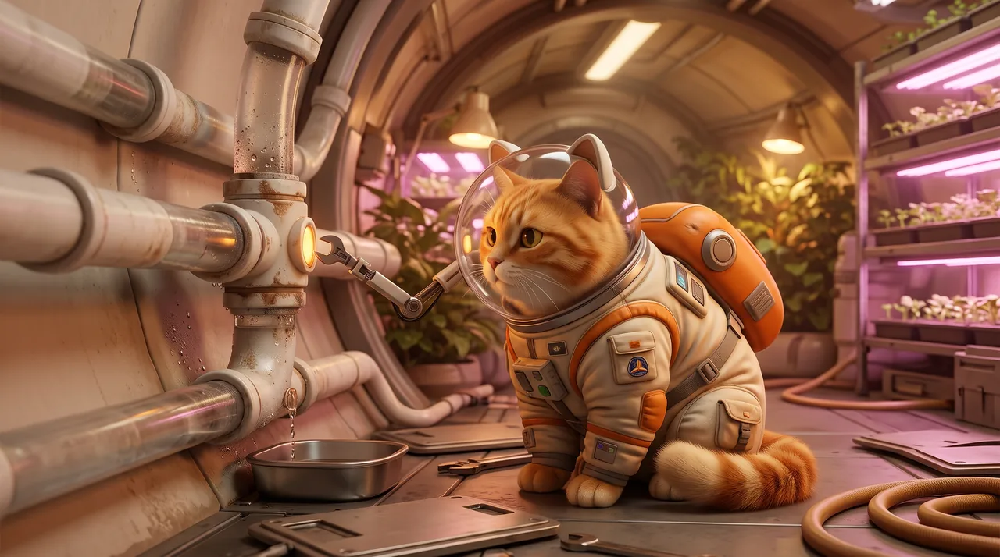
  - 檔名：`scenes/34-water-line.webp`
- 簡報圖：無。
- 評價：✅ 圖文一致。

### L3 — 二氧化碳超標（Carbon Dioxide Rising）
- 類別／角色：lifeSupport／銀白；Sol 3–6，`lifeSupport < 60`。
- 簡報文：「洗滌器飽和了。火星{{氣壓}}不到地球的 1%，基地必須自己淨化空氣。」
- 選項：
  1. 啟動備用洗滌器（⚡−10／💧+12；pressure）
  2. 全員減少活動（💧+6／❤️−2）
  3. 手動更換濾芯（💧+10／❤️−6；20% 失敗 💧−6／❤️−6）
- 圖片：`scenes/36-co2-scrubber.webp` — 銀白在敞開的圓形濾芯艙前按控制面板，地上有備用濾芯，螢幕顯示濃度條與分子符號。
  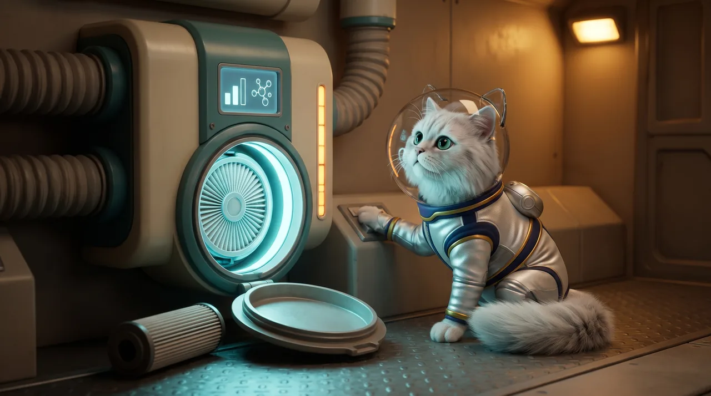
  - 檔名：`scenes/36-co2-scrubber.webp`
- 簡報底板：`36-co2-scrubber-nocat.webp`（只在 sol 超出 1–7 時當後備）。
- 評價：✅ 圖文一致；另外事件卡上多了水與燃料工廠入口。

### S1 — 太陽閃焰警報（Solar Flare Warning）
- 類別／角色：shield／銀白；Sol 4 固定。
- 簡報文：「2025 年 5 月 14 日偵測到強烈{{太陽閃焰}}。光已經到了，粒子雲可能隨後而來。」
- 選項：
  1. 替防護外牆加厚（⚡−20／🛡️+25；solarFlare）
  2. 全員進避難艙（🍖−1／❤️+5）
  3. 硬撐繼續發電（⚡+18／🛡️−14／❤️−6）
- 圖片：`scenes/08-control-room.webp` — 三隻貓在控制室，牆上大螢幕有火星、太陽與警示圖示。
  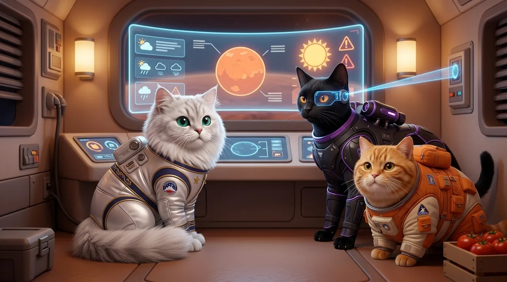
  - 檔名：`scenes/08-control-room.webp`
- 簡報底板：`08-control-room-nocat.webp`（只在 sol 超出 1–7 時當後備；Sol 4 的日誌固定用這張）。
- 評價：✅ 對；不是「外面有閃焰」，而是「控制室收到警報」，與文案一致。

### S2 — 微隕石擊穿外牆（Micrometeorite Breach）
- 類別／角色：shield／暗影；Sol 2–6，`shield < 60` 或 S1 已結算，且 `shield < 80`。
- 簡報文：「{{微隕石}}打穿外層遮蔽，{{輻射遮蔽}}變薄了。」
- 選項：
  1. 修補外殼（⚡−6／🛡️+10；micrometeorite）
  2. 封艙減壓（💧−6／🛡️+6）
  3. 先監測（⚡−2／🔬+2；25% 失敗 ⚡−2／🛡️−15／🔬+2）
- 圖片：`scenes/31-meteorite-breach.webp` — 夜裡暗影檢查艙壁上的新破洞，粉塵飄出，維修無人機在旁。
  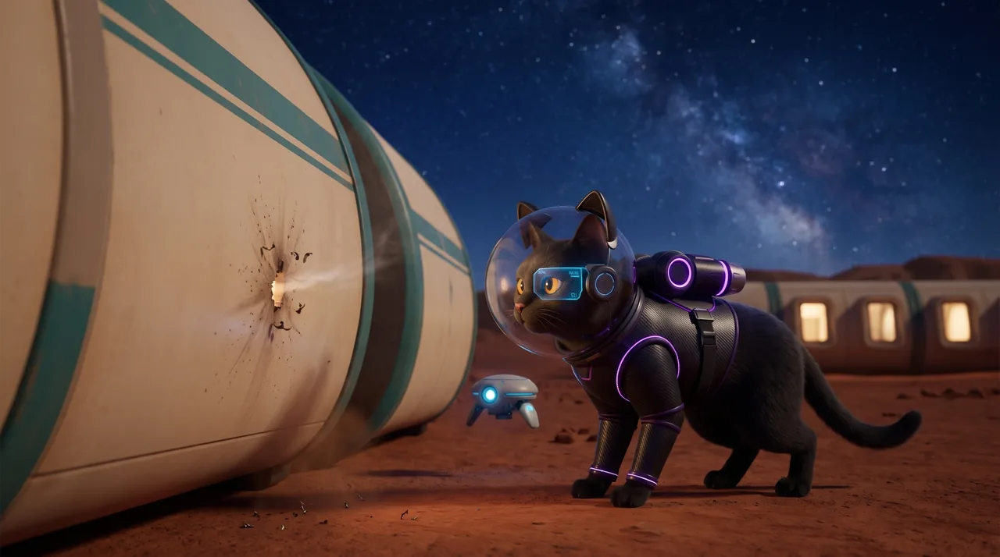
  - 檔名：`scenes/31-meteorite-breach.webp`
- 簡報圖：無。
- 評價：✅ 圖文一致。

### S3 — 避難艙檢查（Shelter Inspection）
- 類別／角色：shield／銀白；Sol 3–5，已收到 `flareForecast` 且 `shield < 75`。
- 簡報文：「{{輻射}}升高了，在下次閃焰來襲前先檢查避難艙。」
- 選項：
  1. 完整檢查（⚡−8／🛡️+12／❤️+2；radiation）
  2. 只查重點（⚡−2／🛡️+6；20% 失敗 ⚡−2／🛡️−6）
  3. 跳過（⚡+6／🛡️−10）
- 圖片：`scenes/33-shelter-door.webp` — 銀白在厚重圓形艙門旁按綠色控制面板，旁邊有毯子與收納箱。
  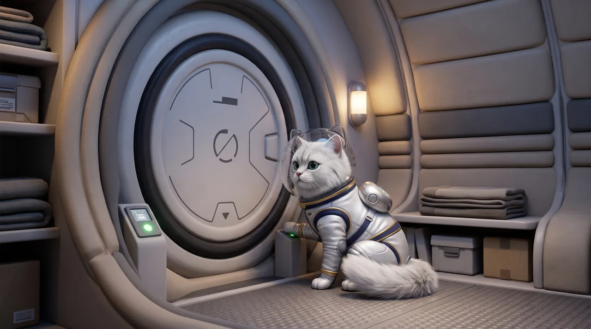
  - 檔名：`scenes/33-shelter-door.webp`
- 簡報圖：無。
- 評價：✅ 圖文一致。

### F1 — 溫室番茄豐收（Greenhouse Tomato Harvest）
- 類別／角色：food／金桔；Sol 3–7，`food ≤ 4`。
- 簡報文：「第一批番茄紅了。金桔等了一整個星期。」
- 選項：
  1. 全部收成（⚡−2／🍖+3；greenhouse；含 PIA25077「岩石不是植物」台詞）
  2. 留種（⚡−2／🍖+2／🔬+1）
  3. 開派對（🍖−1／❤️+10）
- 圖片：`scenes/09-greenhouse.webp` — 溫室裡金桔看著幼苗與澆水機械臂，檯面上一顆熟番茄。
  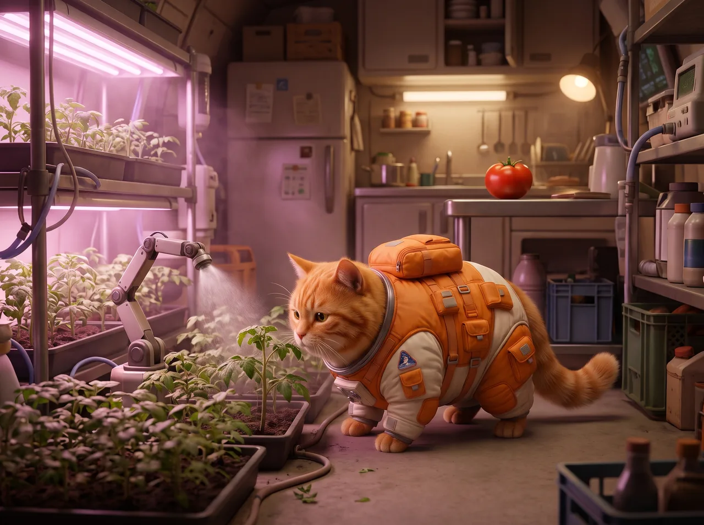
  - 檔名：`scenes/09-greenhouse.webp`
- 簡報底板：`09-greenhouse-nocat.webp`（只在 sol 超出 1–7 時當後備；Sol 7 的日誌固定用這張）。
- 評價：🔶 尚可。圖是「溫室照顧中」，不是「豐收」；只有一顆番茄、沒有收成箱。標題說豐收，畫面稍微保守。

### F3 — 補給箱延誤（Supply Crate Delayed）
- 類別／角色：food／金桔；Sol 2–6，`food ≤ 4` 或 `commsWindow`，且 `food < 5`。
- 簡報文：「補給箱延誤了。{{通訊延遲}}讓地球無法即時處理。」
- 選項：
  1. 配給（🍖+1／❤️−3；commsDelay；先開翻卡）
  2. 吃庫存（⚡−4／🍖+2／❤️+1；先開翻卡）
  3. 派探測車（⚡−12／🍖+4／❤️−4）
- 圖片：`scenes/35-supply-crate.webp` — 黃昏時金桔按著貨運控制台，旁邊是空補給托架、堆疊補給箱，遠處有探測車。
  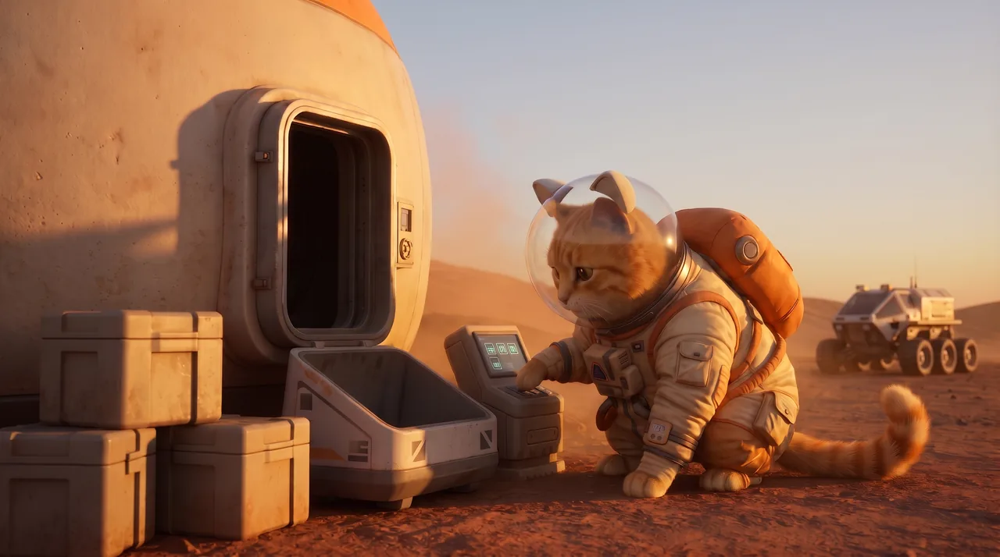
  - 檔名：`scenes/35-supply-crate.webp`
- 簡報圖：無。
- 評價：✅ 圖文一致（空的托架就是「還沒到」）。

### C1 — 地球來電（Call from Earth）
- 類別／角色：comms／暗影；Sol 3–5，`commsWindow` 已開。
- 簡報文：「今天的{{通訊延遲}}是 14 分鐘，地球的回覆還得等上一陣子。」
- 選項：
  1. 等地球回覆（🍖−1／🔬+1）
  2. 派探測車中繼（⚡−6／🔬+3；commsDelay）
  3. 自己決定（❤️−2／🔬+1；30% 失敗 ❤️−6／🔬+1）
- 圖片：`scenes/39-earth-call.webp` — 通訊艙內，暗影伸手操作無線電台；螢幕上地球與火星由虛線訊號弧連著，圓窗外是碟型天線。
  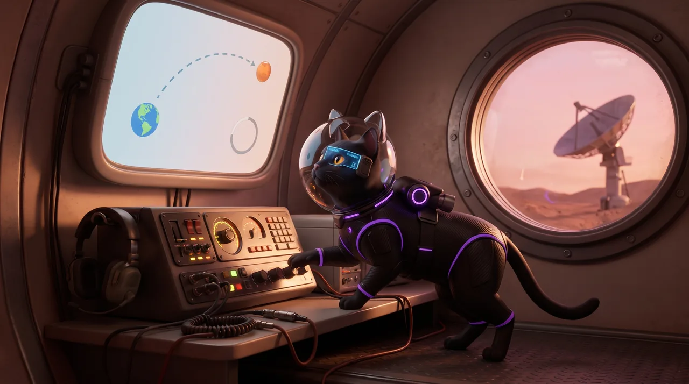
  - 檔名：`scenes/39-earth-call.webp`
- 簡報底板：`39-earth-call-nocat.webp`（空無一貓的通訊艙；也用作 Sol 6 艦長日誌大圖）。
- 評價：✅ 對題。控制台、耳機、訊號弧與天線把「地球來電」講清楚，暗影也在畫面裡。

### SC2 — 地下冰探測（Subsurface Ice Survey）
- 類別／角色：science／銀白；Sol 2–6，`science < 6`；Sol 5 保底。
- 簡報文：「探測車找到訊號。會是{{地下冰}}嗎？」
- 選項：
  1. 鑽探（⚡−10／💧+2／🔬+4；subsurfaceIce）
  2. 雷達掃描（⚡−6／🔬+2）
  3. 標記位置（⚡+2／❤️−2／🔬+1）
- 圖片：`scenes/40-ice-survey.webp` — 銀白蹲在探測車降下的鑽頭旁，小鑽孔周圍散著冰晶，前掌按著掃描器，車上螢幕顯示地表下的亮層。
  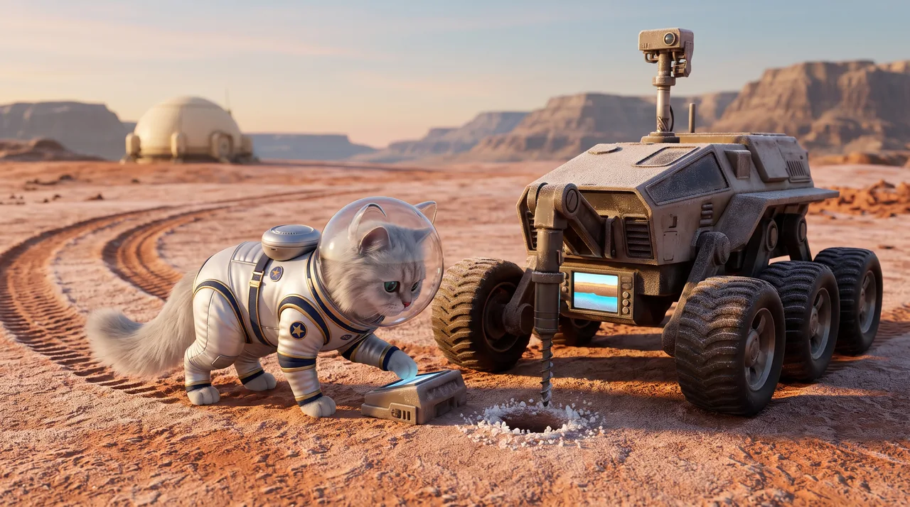
  - 檔名：`scenes/40-ice-survey.webp`
- 簡報底板：`40-ice-survey-nocat.webp`（沒有貓，只剩探測車、鑽孔與車轍）。
- 評價：✅ 對題。鑽孔、冰晶與螢幕亮層直接對到「探測車找到訊號」；銀白也在操作，符合 science／銀白。

---

## 七個 Sol 簡報（艦長日誌）

簡報文由 `src/game/daily.ts` 的 `DAILY_BRIEFS` 固定；**大圖自 2026-11-15 起也固定**，由 `SOL_BRIEF_ART`（`src/game/eventArt.ts`）對應，不再借當天事件圖。同一 sol 無論抽到哪張卡，簡報大圖都一樣；事件卡自己的圖只在下面「今日突發事件」那行出現。

| Sol | 固定簡報文（zh-TW） | 術語 | 簡報大圖 |
|---|---|---|---|
| 1 | 第 1 個 {{sol}}。火星{{gravity}}是地球的 38%。身體還在適應，動作慢一點。 | sol、gravity | `01-keyart.webp`（三貓岩脊） |
| 2 | {{dustDevil}}是小型的旋風，和大範圍的{{dustStorm}}不一樣。 | dustDevil、dustStorm | `11-cold-patrol-nocar.webp`（車轍＋塵捲風） |
| 3 | 目前發布了閃焰預報，同時通訊窗口也開啟了。地球大約在 14 光分之外。 | solarStorm、solarWind、commsDelay | `42-dish-forecast.webp`（天線＋低日） |
| 4 | 太陽粒子事件時，避難艙是最安全的地方。需要之前先檢查{{radiationShielding}}。 | solarFlare、radiation | `08-control-room-nocat.webp`（控制室） |
| 5 | 水很重，所以基地幾乎每一滴都淨化再利用。 | waterRecycling、oxygenRecovery | `41-water-recycling.webp`（水回收艙） |
| 6 | 地球的無線電回覆單向要 3 到 22 分鐘。船員必須自己決定。 | commsDelay、pressure | `39-earth-call-nocat.webp`（通訊艙） |
| 7 | {{greenhouse}}很小，但新鮮食物對健康和士氣都有幫助。 | greenhouse、subsurfaceIce | `09-greenhouse-nocat.webp`（溫室） |

### 逐日（含英文原文）

**Sol 1** — `Sol 1. Mars gravity is 38% of Earth’s. Your body is still adapting, so move slowly.`
- 簡報圖：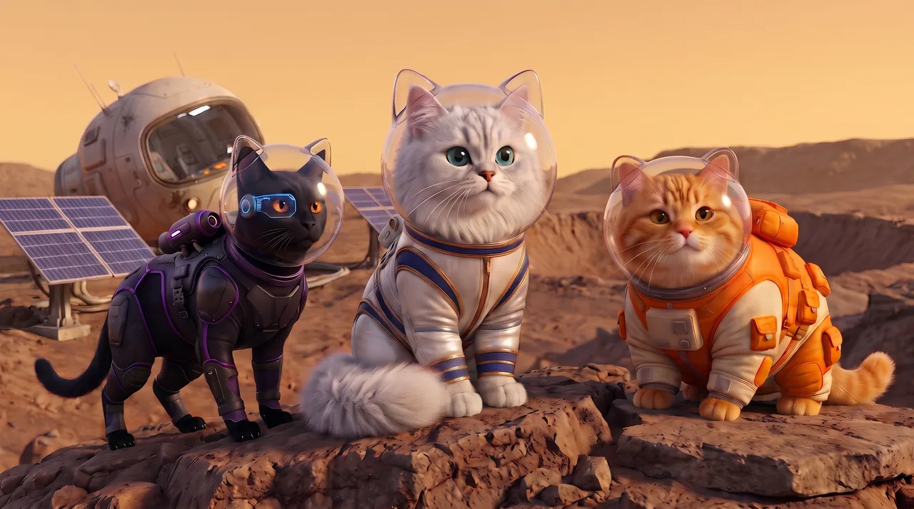
  - 檔名：`scenes/01-keyart.webp`

**Sol 2** — `Dust devils are small whirlwinds. They are not the same as a large dust storm.`
- 簡報圖：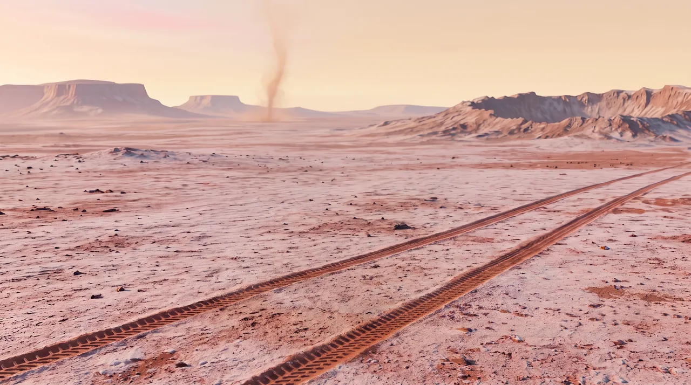
  - 檔名：`scenes/11-cold-patrol-nocar.webp`

**Sol 3** — `A flare forecast is open, and the comms window is open. Earth is about 14 light-minutes away.`
- 簡報圖：
  - 檔名：`scenes/42-dish-forecast.webp`

**Sol 4** — `The shelter is the safest place in a solar particle event. Check the shielding before you need it.`
- 簡報圖：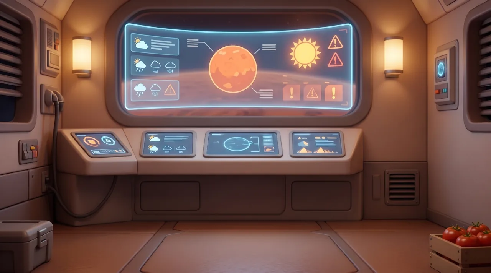
  - 檔名：`scenes/08-control-room-nocat.webp`

**Sol 5** — `Water is heavy, so the outpost cleans and reuses almost every drop.`
- 簡報圖：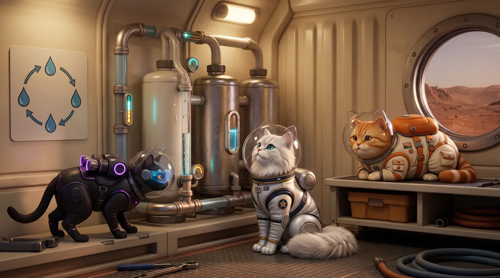
  - 檔名：`scenes/41-water-recycling.webp`

**Sol 6** — `A radio reply from Earth can take 3 to 22 minutes one way. The crew has to decide on its own.`
- 簡報圖：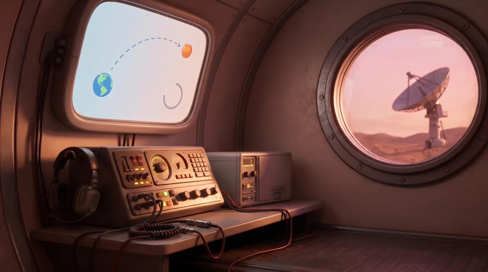
  - 檔名：`scenes/39-earth-call-nocat.webp`

**Sol 7** — `The greenhouse is small, but fresh food helps both health and morale.`
- 簡報圖：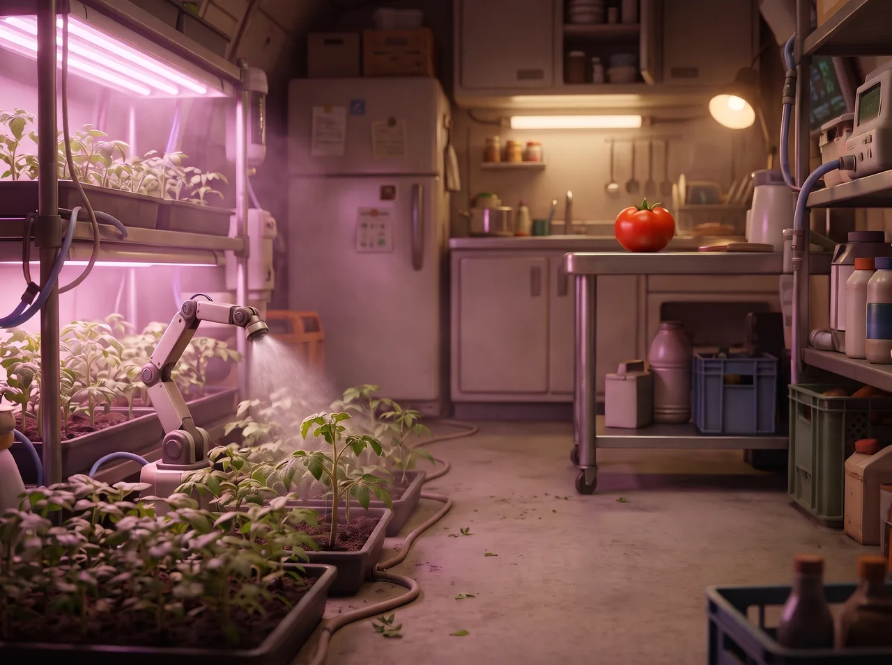
  - 檔名：`scenes/09-greenhouse-nocat.webp`

> 2026-11-15 已改為固定 sol 圖；`BriefingScreen` 先讀 `briefArtForSol(sol)`，只有 sol 超出 1–7 才退回 `briefingArtFor(event.id)`。

## 處理結果（2026-11-15）

1. **P4** → `38-cold-week`（結霜基地＋暖氣）✅
2. **C1** → `39-earth-call`（通訊艙＋訊號弧）✅
3. **SC2** → `40-ice-survey`（鑽孔＋地層亮層）✅
4. **艦長日誌** → 改成每 sol 固定圖（Sol 3 用新的 `42-dish-forecast`、Sol 5 用 `41-water-recycling`）✅
5. 其餘 9 張（T1、P1、L1、L2、L3、S1、S2、S3、F3）未動；`11-cold-patrol`、`07-base-exterior`、`26-silver-wide` 目前不再進打包。

## 可用的替代素材（已存在但未使用）

- `10-night-repair.webp`：夜間維修場景，可考慮給 L1 或夜間故障類事件。
- `11-cold-patrol.webp`：P4 舊圖，巡邏感；目前未使用。
- `27-shadow-wide.webp`、`28-ginger-wide.webp`、`20-silver-hero.webp`：角色遠景，可當備用。
- 新圖遵守 `docs/licenses.md` 與現有生成流程；配圖邏輯只改 `eventArt.ts`。
