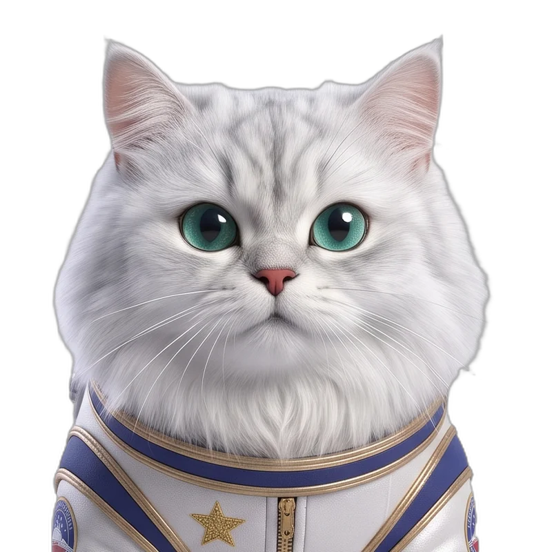

# 已處理圖像資產（2026-11-14）

此資料夾是工作區 `pic/` 原圖的網頁用衍生物，供遊戲與 submission 使用。
**原圖未被修改或覆寫**（仍在 repo 外的 `C:\Projects\Meow\pic`）。

## 目錄

| 路徑 | 內容 |
|---|---|
| `scenes/` | 20 張有背景的場景、劇照、對話頭像、英雄鏡、遠景與故事板，WebP（不透明） |
| `cutouts/` | 9 張去背角色設定表（14–19 與 `_hat` 頭盔版），WebP（透明 alpha） |
| `avatars/` | 36 張單格頭像（3 貓 × 6 表情 × 有／無頭盔），每張 200／400／800 px，共 108 個 WebP |
| `manifest.json` | 每張設定表圖的尺寸、bytes、處理參數、英文與繁中 `alt`、`credit`；頭像另有 `avatars/manifest.json` |

## 規格

- **場景**：最長邊 1280 px（Lanczos）、WebP q=82、單張 ≤ 250 KB；實測 42–147 KB。
- **去背**：最長邊 1600 px、rembg 2.0.87（`bria-rmbg`、CPU）、WebP q=85；
  alpha 0–255、透明像素占比已記在 manifest，深色與米色底皆無白邊。
- 原圖 207 MB → 設定表 3.94 MB（場景 1.87 MB、去背 2.07 MB）；
  加上頭像三種尺寸 4.09 MB，全部共 8.03 MB。
- 去背素材保留原本 **3 欄 × 2 列** 六格排版（六視圖／六表情）；
  單格頭像另放在 `avatars/`。

## 頭像（`avatars/`）

六張表情表（17–19 與 `_hat`）切成 **3 隻貓 × 6 表情 × 2 版本 = 36 張**，
每張提供 **200／400／800 px** 三種寬度，共 108 個 WebP。

- 表情順序（3×2，由左至右、由上至下）：
  `neutral`、`happy`、`worried`、`determined`、`sleepy`、`surprised`。
  Shadow 第二格偏「quietly pleased」，`alt` 照實描述。
- 檔名：`avatar-{cat}-{expression}.webp`；頭盔版加 `-helmet`。
  800 px 為主檔，另有 `-400.webp`、`-200.webp`。
- 切法：用整格寬度做 800×800 頂部對齊方形裁切，不裁耳朵與鬍鬚，只切掉下半身。
- `avatars/manifest.json` 提供每張的 `src`、`srcset`、bytes 與中英 `alt`。
- 不用開圖的完整說明與檔名對應表：[`avatars/README.md`](avatars/README.md)。
- HUD 小頭像用 200 或 400、大圖才用 800；不要一次載入全部 36 張。

```html

```

> 上例路徑以 `avatars/` 為基準；實際前綴依 Vite 的 import 或 `public/` 設定調整。

## 使用規則

- 11/14 MVP 只會打包 8 張：`23`、`24`、`25`、`01`、`05`、`06`、`07`、`08`（合計 779 KB）；
  其他圖（含 36 張頭像）是替換與後續使用的素材，不代表全部載入。
- `manifest.json` 的 `alt.en`／`alt.zh-TW` 可直接給 ``；
  `credit` 皆為 `null`（本批為 AI 生成圖，不是 NASA 照片）。
- 去背圖的 alpha 已保留，可直接疊在 `--paper`、`--navy` 或場景圖上。
- 14–19 設定表保留原 3×2 排版；單格頭像已切在 `avatars/`，不用再自行切格。
- 14–16 原圖有部分視圖的腳掌被原圖邊界裁掉，去背不會補回。
- 不要覆寫 `pic/` 原圖；重出圖時沿用 `docs/image-prompts.md` 的同一批 prompt。

## 產製

Pillow 縮圖（Lanczos）＋ WebP；去背用本機 rembg（`bria-rmbg`，CPU）。
處理腳本不在 repo 內；完整參數記在 `manifest.json` 的 `pipeline` 欄位。
